# RCC Beam Designer (IS 456:2000)

RCC Beam Designer is a comprehensive, open-source desktop application built with Python and PyQt5 for the structural design, analysis, and detailing of Reinforced Concrete (RCC) beams according to the Indian Standard IS 456:2000. Developed by Ranvir Kumar at the Indian Institute of Technology Kharagpur, it features a modern, interactive GUI that guides engineers through limit state flexural design, shear design, serviceability checks, and rebar detailing, culminating in professional PDF reports and CAD drawing exports.

## Key Features
* **Flexural Design:** Automatic calculation of required tension steel, seamlessly handling both singly and doubly reinforced limit states.
* **Shear Design:** Computation of shear capacities (Table 19 & 20) and optimized two-zone stirrup spacing for simply supported beams.
* **Serviceability:** Deflection control checks using empirical L/d ratio methods (Clause 23.2).
* **Detailing & Drafting:** Automated bar selection, spacing validation, and real-time cross-section/longitudinal CAD-style previews.
* **Comprehensive Exporting:** Generate detailed PDF calculation reports, DXF engineering drawings, and Excel data summaries.

---

## Installation & Running via PowerShell

To run the software locally on a Windows machine, follow these complete steps using PowerShell:

**Step 1: Open PowerShell**
Press the `Windows` key, type `PowerShell`, and hit `Enter`.

**Step 2: Clone or Navigate to the Project Directory**
Navigate to the folder where you have downloaded or cloned the source code.
```powershell
cd path\to\RCC_Beam_Designer
```

**Step 3: Create a Virtual Environment**
Create an isolated Python environment to prevent dependency conflicts.
```powershell
python -m venv venv
```

**Step 4: Activate the Virtual Environment**
Activate the environment so that packages are installed locally to this project.
```powershell
.\venv\Scripts\Activate.ps1
```
*(Note: If you receive an execution policy error, run `Set-ExecutionPolicy -ExecutionPolicy RemoteSigned -Scope CurrentUser` first).*

**Step 5: Install Required Dependencies**
Install the necessary third-party libraries for the UI and export engines.
```powershell
pip install PyQt5 reportlab ezdxf openpyxl
```

**Step 6: Launch the Application**
Run the main script to start the graphical interface.
```powershell
python main_8.py
```

---

## Architecture & Logic

* **Beam Design Logic:** The software follows a rigorous limit state design sequence, evaluating flexural limits before progressing to shear and serviceability checks, and iterating on bar selection if detailing fails.
  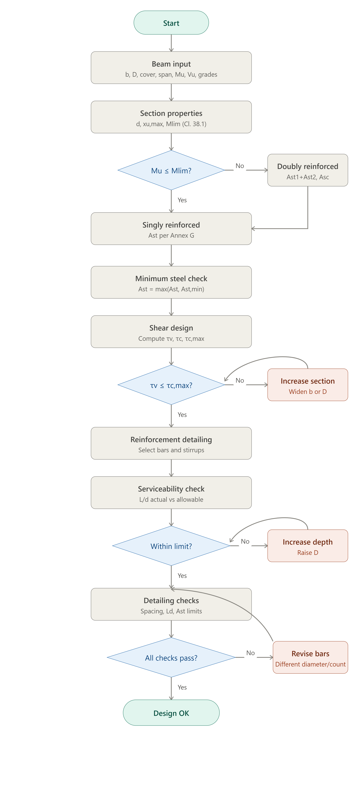
* **Application Architecture:** The desktop GUI is structured linearly through a `QStackedWidget` wizard, ensuring a single shared state (`DesignSession`) governs the data across all UI pages and export modules.
  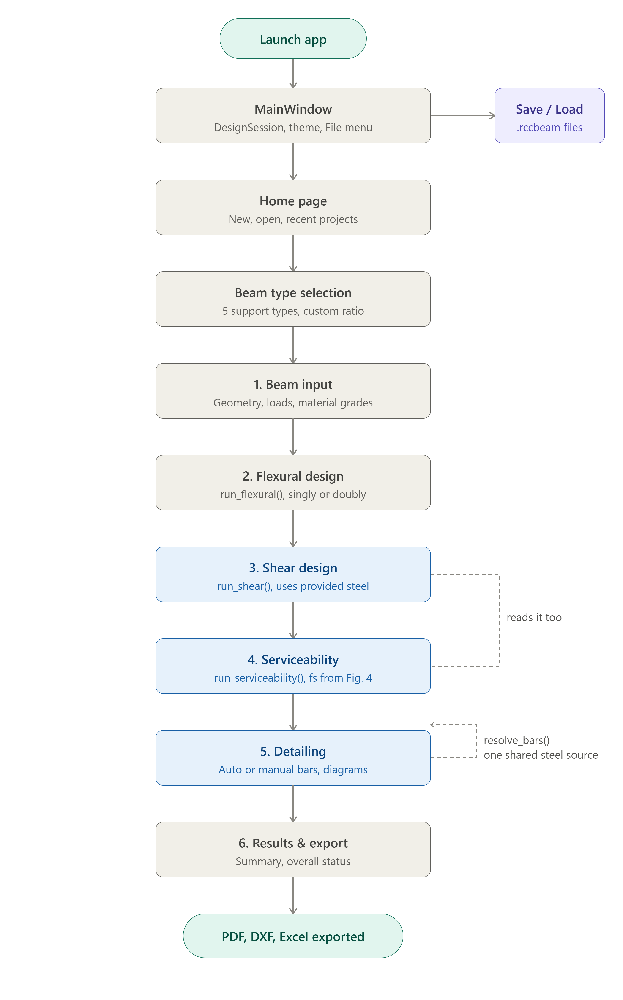

---

## Application Walkthrough & Screenshots

* **1. Home Screen:** The application opens to a modern welcome dashboard where you can start a new project or resume a recent one.
  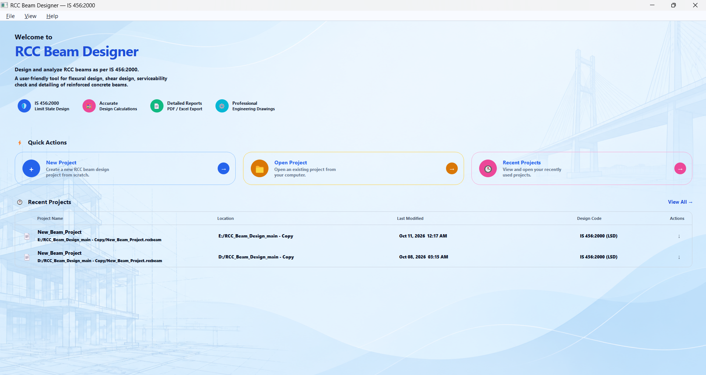

* **2. Beam Selection:** Choose the appropriate support conditions (Simply Supported, Cantilever, Continuous, Fixed, or Custom) to set the baseline empirical parameters.
  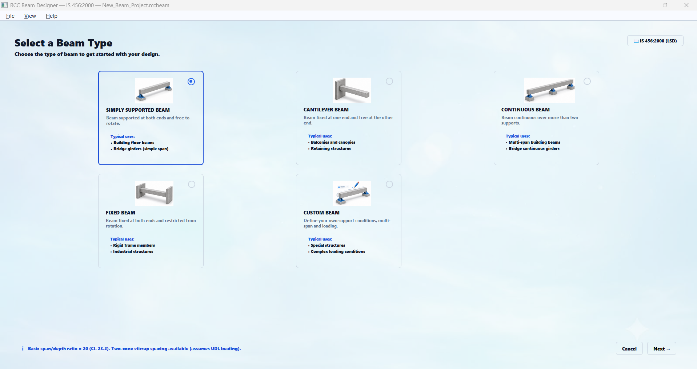

* **3. Beam Input Parameters:** Define the core geometry, concrete/steel material grades, and the factored design loads (Mu and Vu).
  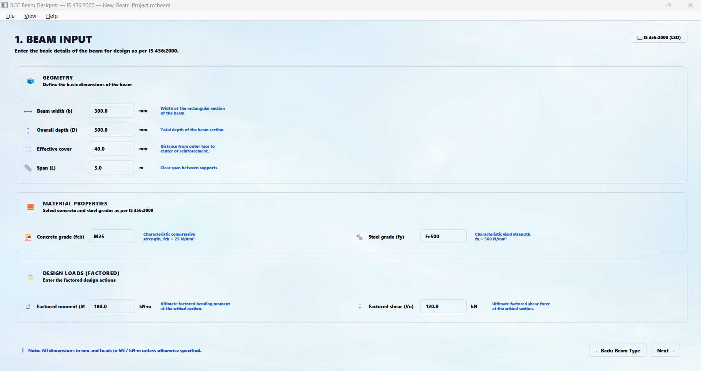

* **4. Flexural Design:** The engine calculates effective depth, neutral axis limits, limiting moment capacity, and the required longitudinal reinforcement, displaying step-by-step mathematical breakdowns.
  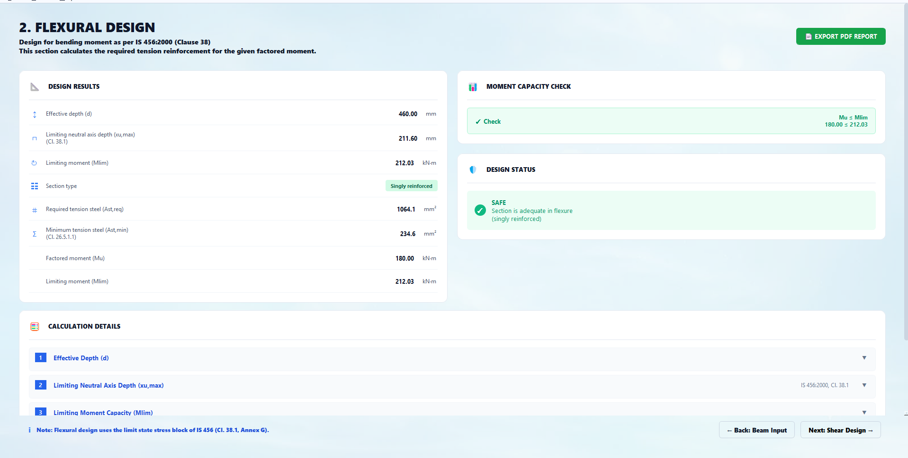

* **5. Shear Design:** Evaluates nominal shear stress against concrete shear strength (Table 19) and maximum permissible shear (Table 20), determining the required stirrup diameter, legs, and spacing.
  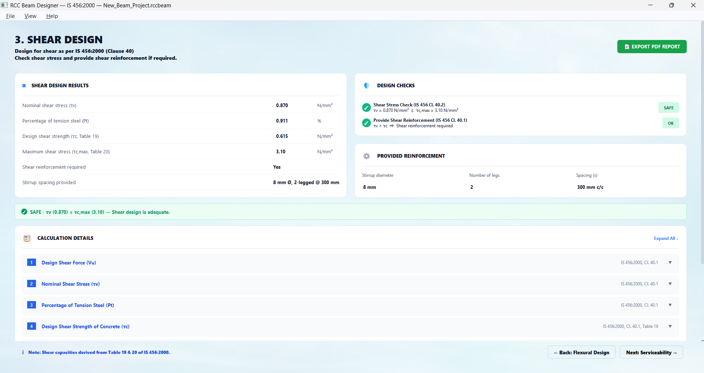

* **6. Serviceability Checks:** Performs limit state of serviceability checks for deflection, computing modification factors to ensure the actual span-to-depth ratio remains within safe bounds.
  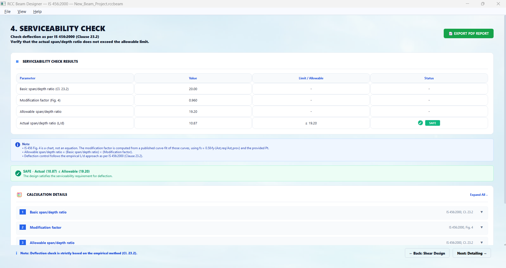

* **7. Detailing Validation:** Validates minimum/maximum steel percentages, clear spacing, and cover against IS 456 Clause 26, allowing users to optionally override auto-selected bars with manual inputs.
  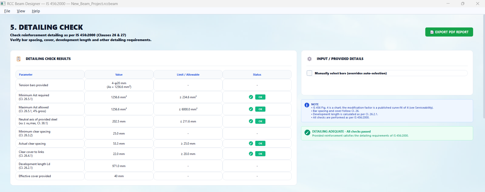

* **8. Engineering Drawings (Cross Section):** Generates real-time, scaled previews of the beam's cross-section and individual stirrup detailing based on calculated reinforcement.
  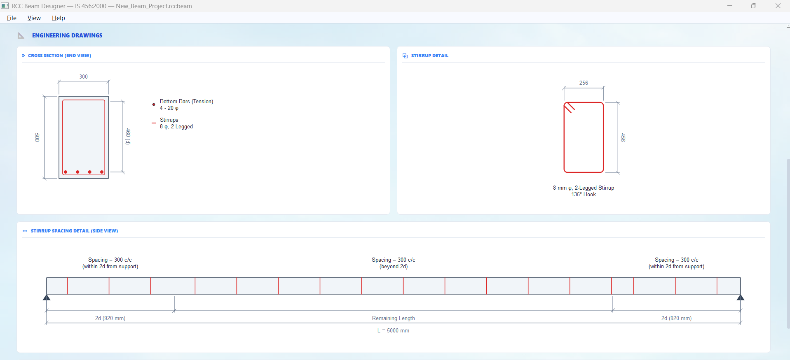

* **9. Engineering Drawings (Longitudinal Section):** Visualizes side-view elevations, highlighting continuous longitudinal rebar runs and varied stirrup spacing zones across the span.
  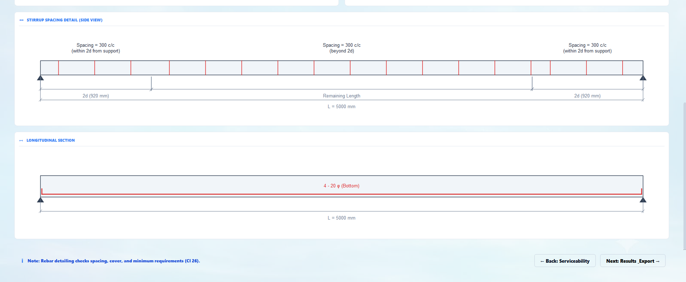

* **10. Results & Export:** A final executive summary dashboard displaying the safety status of all structural checks, with direct export buttons for PDF reports, DXF drawings, and Excel spreadsheets.
  
